# Obsidian Proofread

Draws proofreading findings on the note itself, so you work through them where the
prose is rather than in a chat log. Hover a highlight for the rule behind it; click it
to correct the text in place and mark it done. The plugin never writes prose for you:
the correction field starts with the note's own words, what replaces them is what you
type, and a vocabulary finding offers a word and its definition, never a rewritten
sentence.

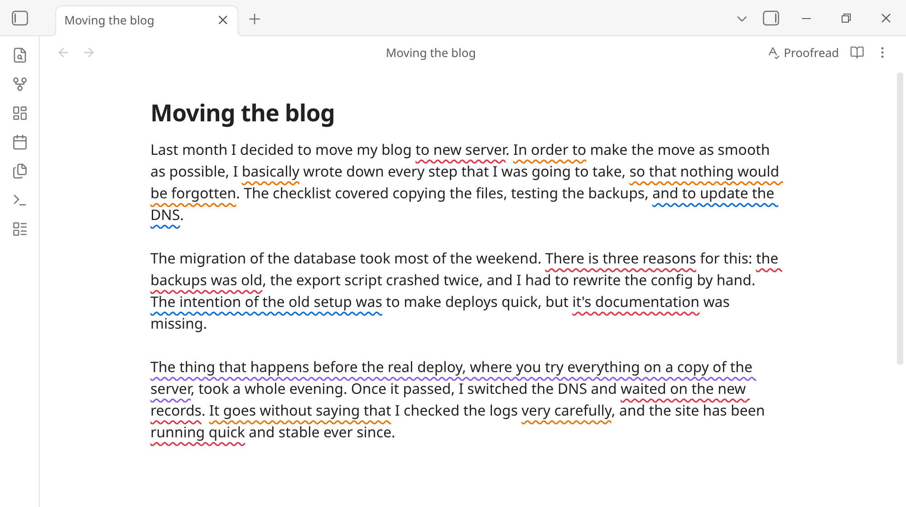

## Getting started

The plugin does not proofread anything itself. It draws a report that the `proofread`
skill for [Claude Code](https://claude.com/claude-code), which lives in this repo,
writes. You need both, and on desktop the plugin can start the skill for you.

1. In Obsidian, open **Settings → Community plugins → Browse**, search for
   [Proofread](https://community.obsidian.md/plugins/proofread), then install and enable it.
2. Install the skill from the [codomaniac marketplace](https://github.com/codomaniac/skills),
   in Claude Code:

   ```sh
   /plugin marketplace add codomaniac/skills
   /plugin install proofread@codomaniac
   ```

3. Open the note and click **Proofread** in its header, or run **Proofread this note
   with Claude Code** from the command palette. The plugin runs `claude` in the vault
   with the model chosen in its settings, and draws the findings when the run ends.
   This needs the desktop app and a signed-in `claude` on the PATH, or its full path
   in the settings.

   From a terminal instead, start Claude Code in the vault's root folder and name the
   note:

   ```sh
   /proofread:proofread content/posts/one.md
   ```

   Either way the skill reads the note, never edits it, and writes its findings to
   `.proofread/content/posts/one.md.json`.
4. The plugin checks the open note for a new report every two seconds, so findings
   written from a terminal appear on their own. Proofread again after revising, and
   the report is replaced.

## What it checks

Each finding falls into one of four categories, drawn in its own colour, and each
names the rule it breaks. The rules come from three books.

| Category | Colour | What it points at | Books |
| --- | --- | --- | --- |
| `mechanical` | red | grammar, punctuation and usage errors: articles, prepositions, agreement, verb forms, tense, commas, apostrophes, hyphens, confused words, dangling modifiers | Hacker and Sommers for the rules; Williams for which ones are real |
| `vocabulary` | accent | a clause describing what one word covers, offered with its definition; a vague noun where the specific one is in hand | Hacker and Sommers |
| `clutter` | orange | words to cut or swap: filler, qualifiers, long words, nominalizations, needless passives, redundancy, hedges, intensifiers, jargon, clichés | Zinsser, Williams, Hacker and Sommers |
| `clarity` | blue | sentences the reader has to untangle: a hidden doer, long openers, interruptions, noun stacks, broken parallelism, misplaced modifiers, unclear pronouns, shifts | Williams, Hacker and Sommers |

- **William Zinsser, *On Writing Well*** — clutter: words doing no work.
- **Joseph M. Williams, *Style: Lessons in Clarity and Grace*** — clarity: whether a
  sentence's characters are its subjects and its actions its verbs. His sorting of
  rules into real, social and invented keeps folklore, such as the split infinitive,
  out of the report.
- **Diana Hacker and Nancy Sommers, *A Writer's Reference*** — correctness: the
  handbook's grammar, punctuation and usage rules, its glossary of confused words,
  and its chapters on wordiness, exact language and sentence clarity.

The same fault gets the same rule name on every run, so the report doubles as the
editing log the handbook asks a writer to keep: the mistakes that keep coming back,
each with the rule that corrects it.

Hover a highlight and its card names the category, the rule, the words it is about
and the lesson behind it:

| | |
| --- | --- |
| 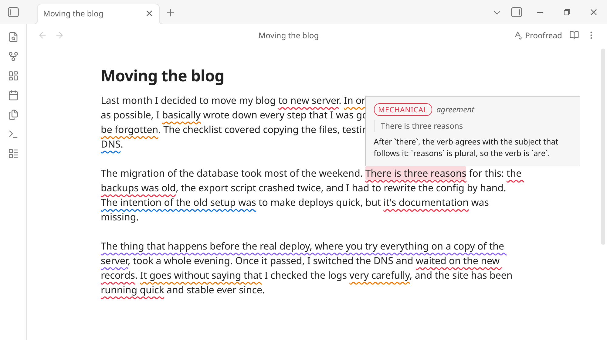 | 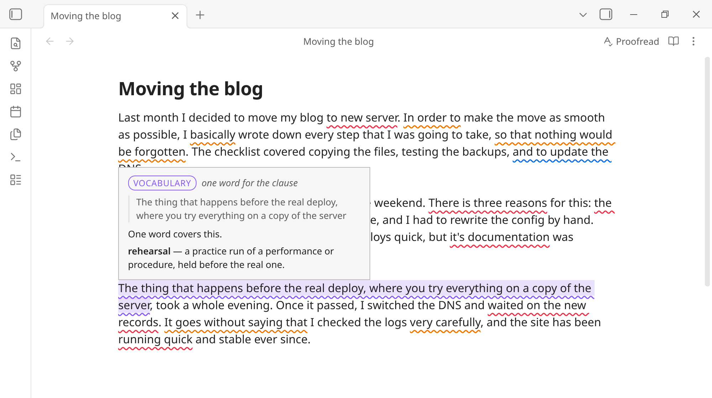 |
| 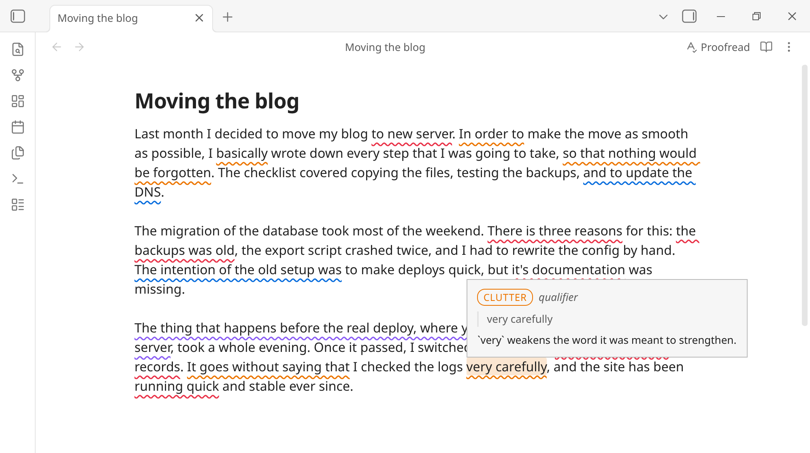 | 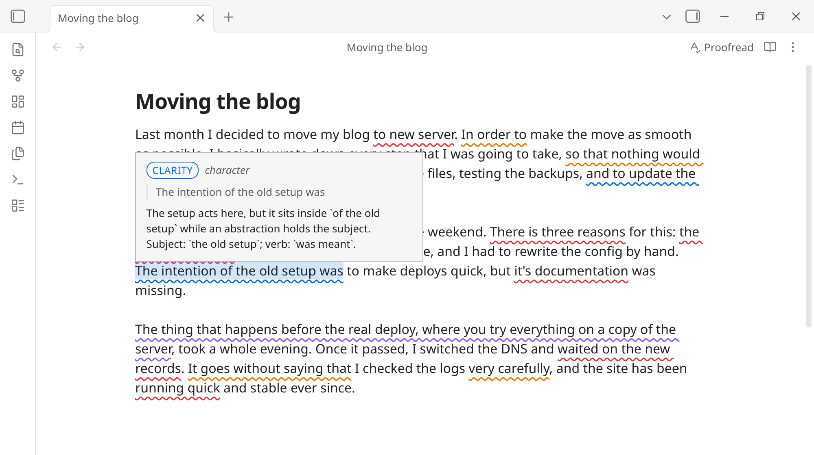 |

## How it works

A proofread run leaves a JSON report per note under `.proofread/`. The plugin reads
the report for whichever note is open, anchors each finding to the text it quotes,
and underlines it in its category's colour.

Findings are anchored by the quoted fragment, not by line number — a model's line
numbers drift, and the note moves under them anyway. Positions are then mapped
through every keystroke, so a highlight never lags behind the text it belongs to,
and a finding whose text has been rewritten stops being drawn rather than sliding
onto prose it was never about.

## The report

`.proofread/<note path>.json`, so `content/posts/one.md` is read from
`.proofread/content/posts/one.md.json`. The folder is dot-prefixed, which keeps it
out of the file explorer, out of search and out of Obsidian's file index.

```json
{
  "file": "content/posts/one.md",
  "findings": [
    {
      "category": "clutter",
      "rule": "qualifier",
      "fragment": "very useful",
      "occurrence": 1,
      "line": 12,
      "note": "`very` weakens the word it was meant to strengthen."
    }
  ]
}
```

| Field | |
| --- | --- |
| `category` | `mechanical`, `vocabulary`, `clutter` or `clarity` |
| `rule` | the named principle — `article`, `qualifier`, `nominalization`, `character` |
| `fragment` | text quoted from the note; the anchor. `...` stands for text skipped |
| `occurrence` | which occurrence of `fragment`, 1-based |
| `line` | 1-based, a tie-breaker only |
| `note` | the sentence stating the rule |
| `word`, `definition` | vocabulary findings: the word being talked around |

A malformed finding is dropped and counted rather than costing the run; the panel
says how many.

Anything else can write that file too; the skill is just the writer this repo ships.

## Using it

- **Hover** a highlight for the category, the rule and the sentence behind it.
- **Click** it to open the same card with a field holding that text. Enter replaces
  exactly the range the finding covers — one ordinary edit, so undo covers it.
- **Resolve** marks it dealt with. **Dismiss** means the rule was read and the word
  stays; a dismissal survives every later run of the same note.
- The panel (`Proofread: open the findings panel`) lists the lot in document order,
  along with findings the note no longer contains and the ones already dealt with.

Clicking a highlight opens the card with the field. What goes in it is yours to type;
**Apply** puts it in the note, **Resolve** marks the finding done without a change,
and **Dismiss** keeps it out of later runs:

| | |
| --- | --- |
| 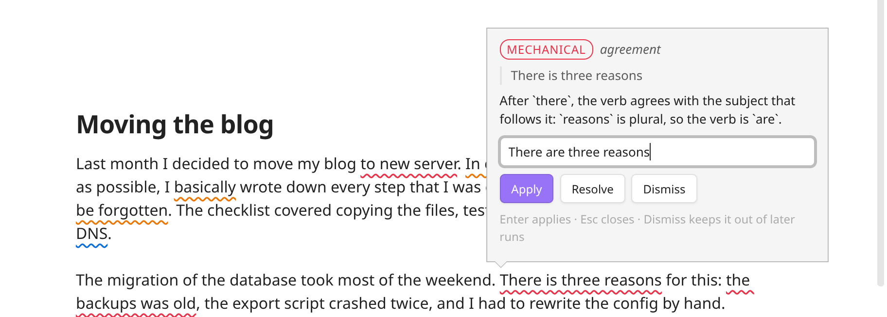 | 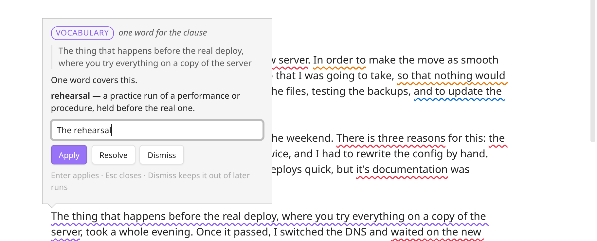 |
| 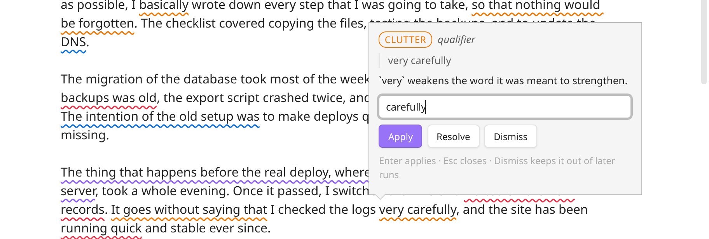 | 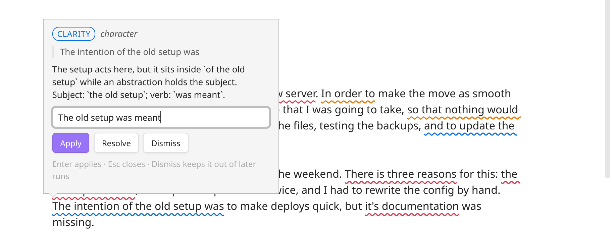 |

The panel lists every finding of the open note, in the order they appear:

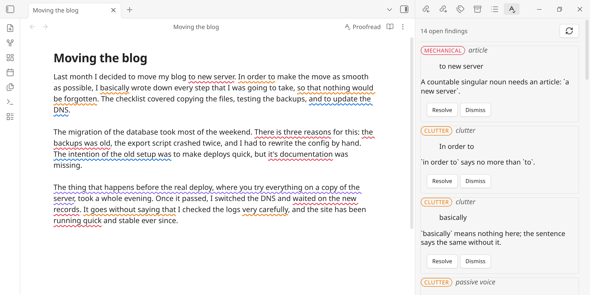

Commands: proofread this note with Claude Code (desktop), reload the report for this
note, open the panel, and bring back everything resolved or dismissed for this note.

Highlights are drawn in Source and Live Preview. Reading view renders its own HTML
and has none of them.

## Settings

| Setting | Default | |
| --- | --- | --- |
| Report folder | `.proofread` | where reports are read from, relative to the vault |
| Check for new reports | 2 | seconds between checks of the open note's report; 0 turns it off |
| Show *category* | on | which of the four categories to draw |
| Open the panel automatically | off | when a note turns out to have findings |
| Claude Code path | `claude` | the executable the Proofread button runs |
| Model | `sonnet` | `sonnet`, `opus`, `haiku` or `fable`; each alias runs the newest model of its line |

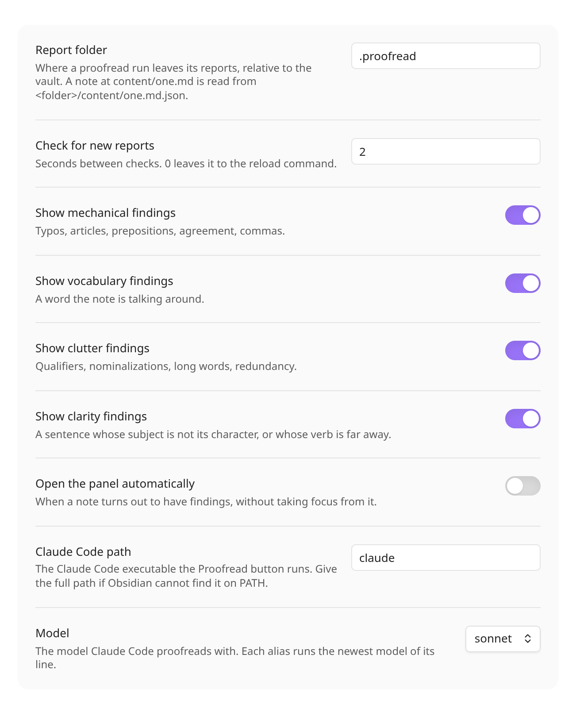

A run started from the plugin may read files but write only under the report folder,
so it can never change the note.

## Building it

Node is not assumed to be on the PATH; the flake carries it.

```sh
nix develop
npm install
npm run build     # type-check, then bundle to main.js
npm test          # anchoring, parsing, position mapping
npm run dev       # rebuild on change
```

To try a local build in a vault, copy `main.js`, `manifest.json` and `styles.css` into
`<vault>/.obsidian/plugins/proofread/`, or symlink the repo there.

## Releasing it

Bump the version in `manifest.json`, `package.json`, `package-lock.json` and
`versions.json`, write the changelog entry, and push a tag named for the version,
without a `v`. The release workflow builds the plugin, checks the manifest against the
tag, and publishes the three files with that changelog entry as the notes.
